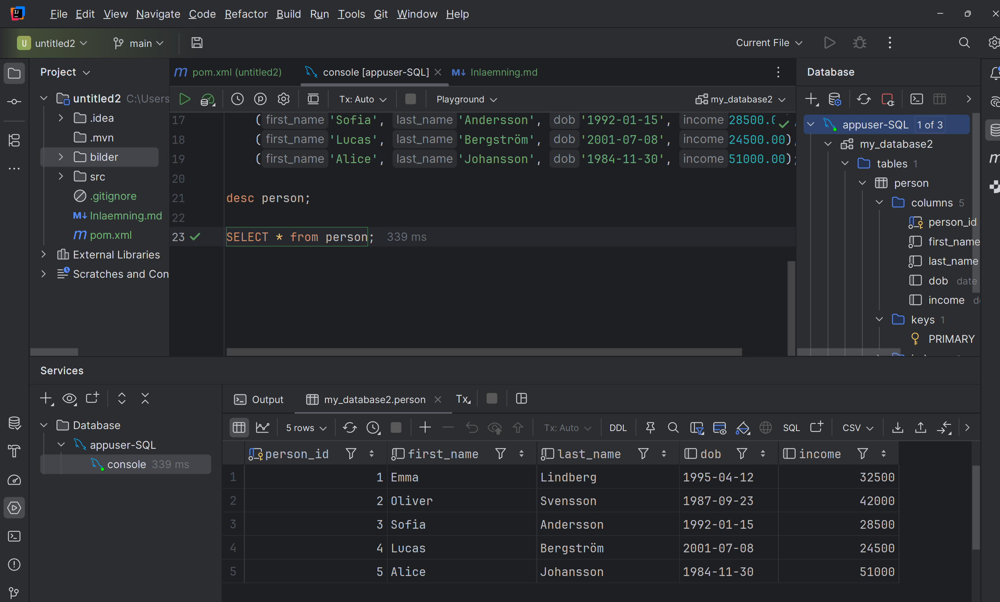
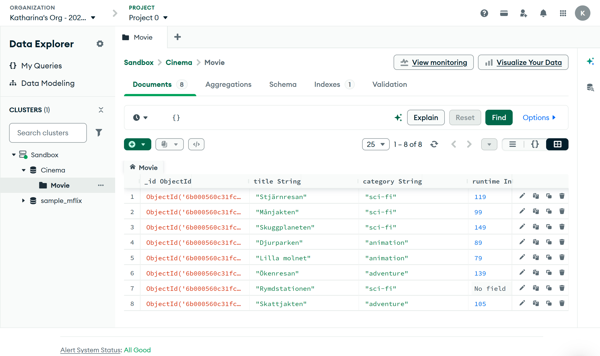
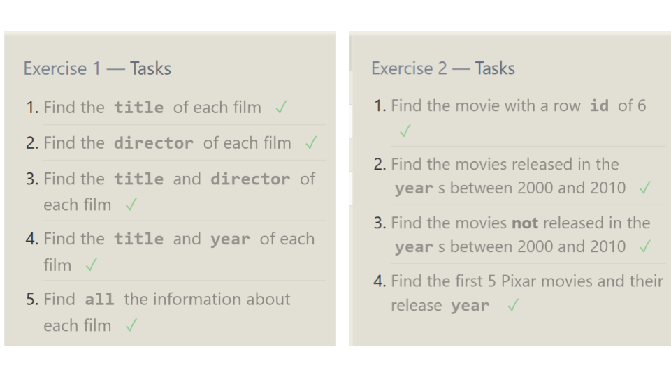
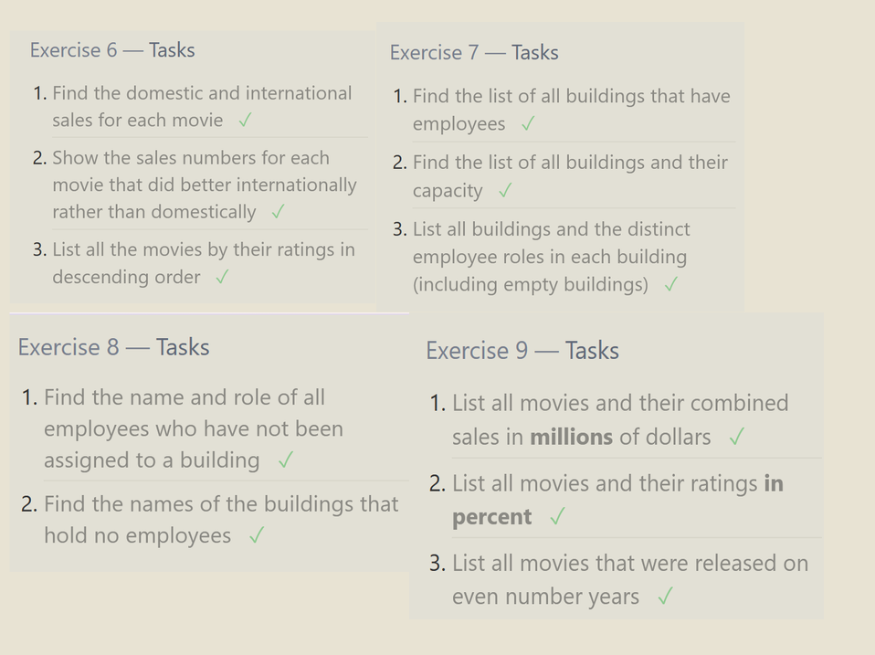

# Labb 1

# MySQL

Skärmdump som visar database explorer i IntelliJ med skapad person-tabell med data:



NOT: Ni ska även ha skapat en user som bara har access till databasen my_database, ingen bild krävs

# MongoDB

Skärmdump av databas på MongoDB Atlas med skapad movie-collection med data:



# SQL

Skärmdump som visar att ni klarat av första två sidorna på sqlbolt.com:s interaktiva tutorial





--- 

# Frågor som ni ska svara på (G-nivå)

Besvara frågorna med egna ord. Ge gärna exempel.

## Databaser och verktyg

**1. Vad är en databas, och vad kan den användas till?**

*En databas är en samling data som lagras på ett någorlunda organiserat sätt. Det enklaste sättet att tänka på en
databas är nog att jämföra den med ett dokumentskåp. Medan dokumentskåpet är den fysiska platsen så är databasen den
virtuella motsvarigheten. Den kan användas för många olika saker. Ett exempel skulle vara en webbshop där en relationell
databas skulle kunna bestå av tabellerna products, customers och orders.*

**2. Vad används språket SQL till?**

*SQL är språket som används för att kommunicera med databaser. Det är till för att läsa och skriva data i databaser.*

## Tabeller och relationer

**3. Vad är en tabell, en rad och en kolumn?**

*För att fortsätta med dokumentskåpsanalogin – när vi lagrar information i dokumentskåpet så kastar vi inte bara in den.
I stället skapar vi "filer" i dokumentskåpet, och data som är relaterade sparas i specifika filer. I en databas kan en '
fil' jämföras med en tabell, och tabellen är en strukturerad samling data. En tabell kan innehålla en lista över kunder,
produkter eller patienter, t.ex.*
*Viktigt att komma ihåg är att informationen som lagras i tabellen ska handla om samma sak. Man bör inte lagra t.ex.
kundlistan och orderlistan i en och samma databastabell.*
*Tabeller innehåller kolumner. En kolumn innehåller en specifik del av information i tabellen, såsom t.ex. id, name,
mejladress osv.*
*Varje tabell har sedan rader. Det är här datan är lagrad. Varje rad motsvarar en "record", alltså en post. I en
kundtabell skulle en rad motsvara en kund med all den information man har sparat om kunden.*

**4. Vad är en primärnyckel, och varför behövs den?**

*Varje rad i en tabell borde ha en kolumn (eller flera kolumner om så behövs) som identifierar radens data på ett unikt
sätt. En kundtabell använder kanske kund-id, medan en ordertabell kanske använder order-id som primärnyckel. Utan en
primärnyckel är det nog svårt att uppdatera eller ta bort vissa rader, eftersom det kan vara svårt att på ett säkert
sätt identifiera exakt vilka rader som ska påverkas.*

**5. Vad är en främmande nyckel?**

*Så som jag har förstått det är det inte bra om samma information lagras flera gånger i onödan, och det är en av
grundprinciperna bakom relationsdatabaser. Tabeller kan vara relaterade till varandra genom gemensamma värden. En
främmande nyckel är i princip en kolumn i en tabell som innehåller värden från primärnyckeln i en annan tabell, för att
på så sätt skapa relationen.*

**6. Varför är det bra att lagra kunduppgifter och köp i olika tabeller?**

*Antar att Emil handlar 5 gånger på Posh & Spicy Webshop. Varje gång han handlar skapas en ny rad i webshoppens
orderdatabas, med uppgifter om ordern och kunduppgifter i samma rad. Emils data dyker upp i varenda en av hans 5
beställningar, på 5 olika rader. Det är onödiga dupliceringar. Och nu händer det att Emil flyttar, hans adress måste då
ändras, och det på 5 olika ställen i databastabellen. Det är onödigt komplicerat och t.o.m. osäkert. Ifall man tex.
missar ett ställe så har kunden Emil två olika adresser i systemet.*
*Det är alltså bättre att lagra kunduppgifter och köp/ordrar i olika tabeller eftersom hantering och bearbetning av
datan blir mer genomförbart. Tabellerna kan ju sedan kopplas ihop genom att en främmande nyckel i ordertabellen
refererar till primärnyckeln i kundtabellen.*

## NoSQL

**7. Vad menas med NoSQL, och hur kan information organiseras i en sådan databas?**

*"Not only SQL" refererar till en typ av databas som inte använder den traditionella relationsmodellen på samma sätt som
SQL-databaser gör. I stället är dessa databaser utformade för att hantera data som är strukturerade som dokument, i
nyckel-värde-par eller som grafer.*
*Data kan t.ex. lagras i JSON-liknande dokument. Varje dokument kan ha sin egen struktur, vilket ger en flexibilitet som
man inte har på samma sätt i traditionella SQL-tabeller. Nyckel-värde-par lagrar data som en uppsättning nycklar med
motsvarande värden. Grafdatabaser organiserar data i noder och relationer mellan dessa.*
*NoSQL-databaser kan hantera stora mängder data, även data som inte har en lika bestämd struktur som i traditionella
SQL-tabeller.*

**8. Ge ett exempel på när en NoSQL-databas kan vara lämplig och förklara varför.**

*Ett exempel kan vara en filmkatalog, som t.ex. Netflix skulle kunna använda. Olika filmer kan ha olika mycket
information. Ett dokument behöver inte ha exakt samma fält som andra dokument. Detta gör det enklare att lägga till ny
information. NoSQL-databaser har en flexibilitet i hur databasens struktur ser ut. En relationsdatabas skulle också
kunna hantera detta, men man kan behöva ändra en gemensam tabell.*

---

## SQL – hämta data från tabellen person

Skriv en SQL-fråga som svar på varje uppgift.

**9. Hämta alla kolumner för alla personer i tabellen.**

   ```sql
   SELECT *
   FROM person;
   ```

**10. Hämta endast förnamn och efternamn för alla personer.**

 ```sql
   SELECT first_name, last_name
   FROM person;
   ```

**11. Hämta förnamn, efternamn och inkomst för personer med en inkomst över 30 000.**

 ```sql
   SELECT first_name, last_name, income
   FROM person
   WHERE income > 30000;
   ```

**12. Hämta alla personer födda före den 1 januari 1990.**

 ```sql
   SELECT *
   FROM person
   WHERE dob < '1990-01-01';
   ```

**13. Hämta förnamn, efternamn och inkomst, sorterat efter inkomst från högst till lägst.**

 ```sql
   SELECT first_name, last_name, income
   FROM person
   ORDER BY income DESC;
   ```

**14. Räkna hur många personer som finns i tabellen.**

 ```sql
   SELECT COUNT(*)
   FROM person;
   ```

---

# VG-nivå

Dessa frågor ska besvaras med ett längre svar, minst en halv A4-sida:

**1. En banköverföring avbryts efter att pengarna dragits från det första kontot.
Vad kan konsekvensen bli, och hur kan en transaktion hjälpa?**

*Vi antar att Emil vill överföra 1000 kronor till Anna. Emil har 5000 kronor på sitt konto och Anna har 2000 kronor. När
överföringen påbörjas dras först 1000 kr från Emils konto. Men innan pengarna hinner sättas in på Annas konto händer
något, t.ex. att systemet kraschar.*

*Om uttaget redan har sparats i databasen har Emil nu bara 4000 kronor kvar på kontot, medan Anna fortfarande har 2000
kronor. Pengarna har alltså dragits från Emils konto utan att komma fram till Anna. Det kan leda till felaktiga
kontosaldon och att banken får problem med att hålla reda på pengarna.*

*FÖr att förhindra detta kan banken använda en transaktion. Det innebär att flera databasoperationer behandlas som en
enda enhet. I det här fallet handlar det om två operationer som hör ihop: att dra pengar från Emils konto och att sätta
in samma belopp på Annas konto. Det viktiga är att båda operationerna måste lyckas för att överföringen ska räknas som
genomförd.*

*När transaktionen startas utför databasen de nödvändiga ändringarna. Om båda operationerna lyckas används COMMIT,
vilket innebär att ändringarna sparas permanent. Om något däremot går fel innan transaktionen har slutförts kan man
använda ROLLBACK för att ångra ändringarna. Om systemet kraschar innan transaktionen har bekräftats kan databasen
automatiskt återställa de ändringar som inte har sparats permanent. Då återgår Emils saldo till 5 000 kronor och Annas
saldo förblir 2 000 kronor.*

*Detta kallas atomicitet och är en del av ACID-principerna. Det betyder att antingen genomförs hela transaktionen eller
så sparas inga av ändringarna. C i ACID står för consistency och betyder att transaktionen får inte bryta mot de regler
och begränsningar som finns. I står för isolation och det handlar om att flera transaktioner inte ska störa varandra på
ett otillåtet sätt om flera av de sker samtidigt. Sist men inte minst, D som står för durability - när en transaktion
har bekräftats med COMMIT ska ändringarna finnas kvar, även om systemet skulle krascha efteråt.*

*Alla fyra principerna är viktiga i ett banksystem. Det räcker inte att pengarna hamnar på rätt konto. Systemet måste
också kunna hantera flera överföringar samtidigt och se till att redan genomförda överföringar inte försvinner vid ett
tekniskt fel.*

*Utan transaktioner skulle banken riskera att få felaktiga saldon, förlorad information och problem med att avgöra vilka
överföringar som faktiskt har genomförts. Genom att använda transaktioner kan banken skydda informationen och se till
att överföringar genomförs på ett säkrare och mer tillförlitligt sätt, förutsatt att båda kontoändringarna ingår i samma
transaktion.*

--- 

**2. Välj ett enkelt system, antingen en webbutik eller en chatt.
Resonera om när en relationsdatabas respektive en NoSQL-databas
kan vara lämplig. Motivera med hur informationen ska lagras och användas.**

*Jag väljer Posh & Spicy Webshop som exempel. Det är en webbutik som säljer kläder, böcker och elektronik. En sådan
webbutik behöver en databas som inte bara kan lagra information, utan också göra det möjligt att snabbt hitta produkter,
genomföra beställningar och hålla reda på lagersaldot. Vilken databas som passar beror därför på vad informationen ska
användas till.*

*Jag skulle välja en relationsdatabas som MySQL för att hantera kunder, beställningar och betalningar. Anledningen är
framför allt att informationen hör ihop och att det är viktigt att allt blir rätt. Om en kund beställer tre produkter
måste systemet exempelvis kunna registrera vilka produkter som ingår i beställningen, beräkna totalsumman och
kontrollera lagersaldot.*

*Det skulle kunna bli problem om en beställning registreras men lagersaldot inte uppdateras. Därför är transaktioner
användbara. De kan se till att flera ändringar antingen genomförs tillsammans eller återställs om något går fel.
Relationsdatabaser passar också bra om webbutiken exempelvis vill ta reda på vilka produkter som säljer bäst eller hur
mycket en viss kund har handlat för. Då kan information från olika tabeller kombineras med SQL-frågor.*

*En NoSQL-databas som MongoDB skulle kunna vara en alternativ för produktkatalogen. Om webbutiken hela tiden får in nya
produkter med olika egenskaper kan det vara praktiskt att inte behöva anpassa en gemensam tabell varje gång. Man skulle
exempelvis kunna lägga till nya produktkategorier och information som bara är relevant för vissa produkter.*

*I MongoDB skulle varje produkt kunna lagras som ett eget dokument. En tröja skulle exempelvis kunna ha information om
storlek, färg och material, medan en bok i stället har information om författare, ISBN och antal sidor. Dokumenten
behöver alltså inte innehålla exakt samma fält.*

*Den här flexibiliteten är också användbar när kunderna söker efter produkter. Om en kund exempelvis vill köpa en svart
tröja i storlek M kan webbutiken söka efter produkter med just dessa egenskaper. Om kunden istället letar efter en bok
kan sökningen göras utifrån författare eller ISBN. Informationen används alltså både för att beskriva produkterna och
för att kunderna ska kunna hitta det de söker efter.*

*Men det finns också nackdelar att fundera över. Om man använder MySQL för beställningar och MongoDB för
produktinformationen måste systemen fortfarande kunna kommunicera med varandra. Om en produkt ändras eller tas bort
behöver man se till att beställningssystemet fortfarande har rätt information. Det kan göra webbutiken mer komplicerad
att utveckla och underhålla.*

*Om jag skulle bygga en mindre version av Posh & Spicy skulle jag därför antagligen välja MySQL för hela systemet. Det
skulle vara enklare att hantera en enda databas, och MySQL kan också lagra produkter med olika egenskaper om man
utformar tabellerna på rätt sätt.*

*Om webbutiken däremot växer och får en mycket stor produktkatalog med många olika typer av information skulle jag kunna
överväga MongoDB för just den delen. Det handlar alltså inte om att den ena databastypen alltid är bättre än den andra,
utan om vilka behov systemet har.*


